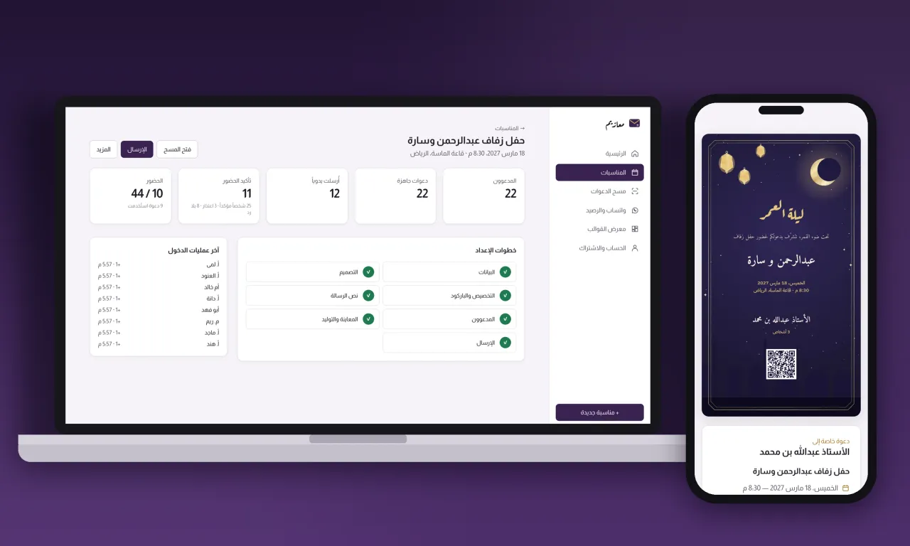
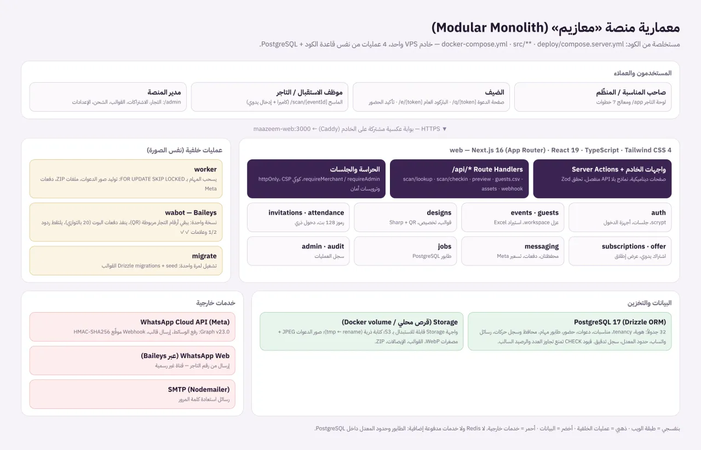
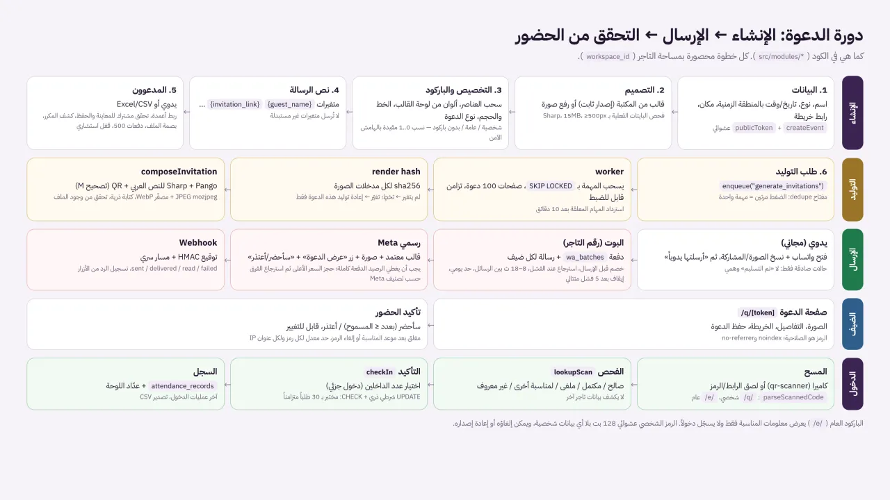
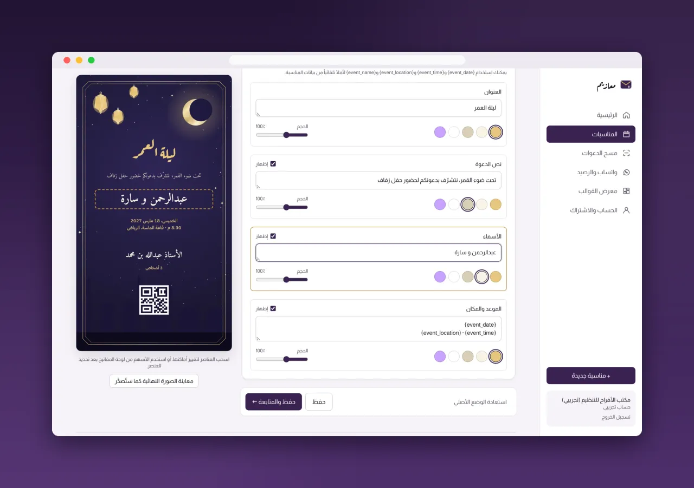
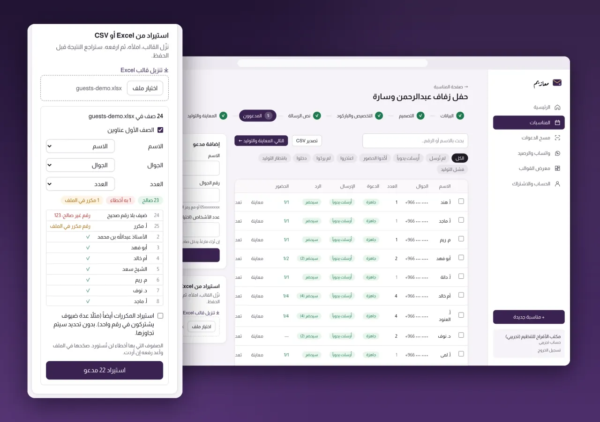
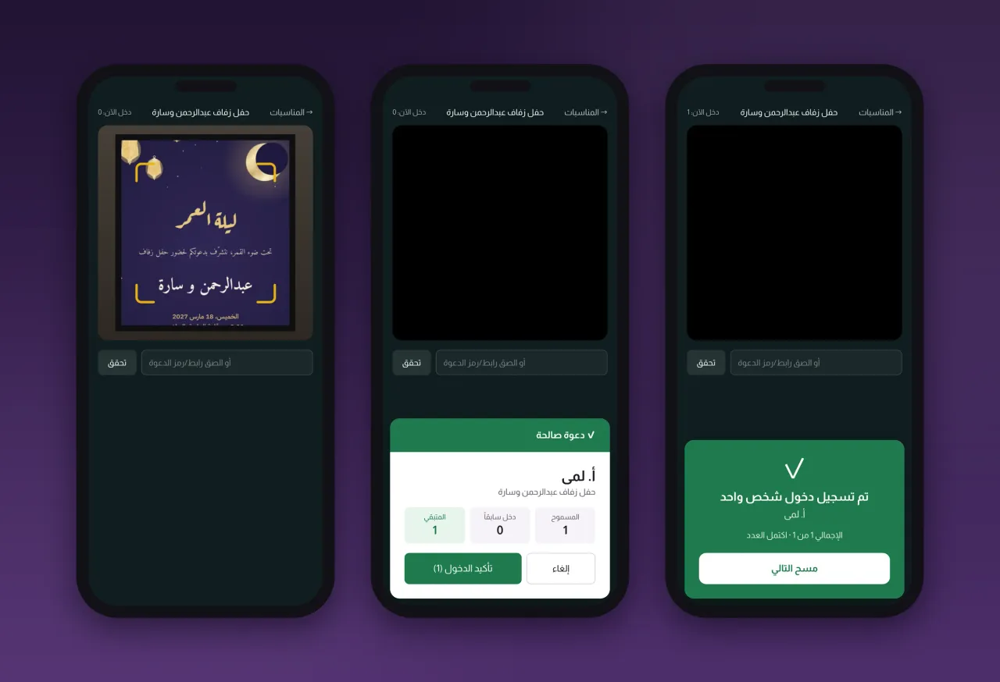

# MAAZEEM · معازيم

Digital invitations and guest management, from the design to the door.

MAAZEEM is a multi-tenant SaaS for people who run events: create the event, design the invitation, add guests, send, track who accepted, and check guests in by QR at the venue. It has been used for real events. It targets Saudi Arabia, Syria, Egypt and the UAE, and works in Arabic and English.

> This repo is a public write-up. The product source is private.
> Full case study: [mohammedkhankan.github.io/khankan-portfolio/en/projects/maazeem](https://mohammedkhankan.github.io/khankan-portfolio/en/projects/maazeem/)

## Numbers

| | |
|---|---|
| Test suite | 52/52 unit and integration tests, run against an isolated real PostgreSQL |
| Excel import | 10,000 guests in 1.84 s |
| Check-in under load | 30 concurrent scans on a 5-person invitation admitted exactly 5 |

## Architecture

A modular monolith: one Next.js codebase, four processes (web, background worker, WhatsApp session service, migrations), one PostgreSQL 17 database. No Redis and no paid infrastructure; the job queue and rate limits live in Postgres.

## Problems worth writing down

**Tenant isolation.** Every query is scoped to the workspace taken from the session. A tenant ID coming from the browser is never trusted, and a dedicated test covers it.

**Check-in races.** Two receptionists scanning the same code at the same second must not admit an extra guest. Check-in is a single conditional `UPDATE` backed by a `CHECK` constraint, so the database refuses the overflow instead of the app hoping it won't happen.

**Background rendering.** Invitation images are rendered in a Postgres-native queue (`FOR UPDATE SKIP LOCKED`). Jobs are de-duplicated, and each invitation carries a render hash, so only what changed is regenerated.

**Excel from the real world.** Guest sheets arrive with Arabic-Indic digits, invisible direction marks and duplicates. The importer normalizes them, catches duplicates, and keeps plan limits correct even when two imports run at once.

**Messaging money.** Two wallets that can't go negative, charge-before-send with an automatic refund on failure, and no duplicate sends after a crash.

**Security basics done properly.** scrypt password hashing, hashed session tokens, DB-backed rate limits, CSP and HSTS, 128-bit invitation tokens, and an audit log for sensitive actions.

## Invitation lifecycle

## Screens

Demo data.

| Invitation designer | Excel import |
|---|---|
|  |  |

## Stack

Next.js 16 (App Router, Server Actions) · React 19 · TypeScript · Tailwind CSS 4 · PostgreSQL 17 · Drizzle ORM · Zod · Sharp + Pango for Arabic invitation rendering · Baileys · Docker Compose

Official WhatsApp Cloud API sending is complete in code and tested against simulated webhooks; it goes live once Meta approves the message templates.

## Next

Official sending, guest categories, scheduled reminders, and a live attendance screen.

---

Built by [Mohammed Khankan](https://github.com/mohammedkhankan) · OFOQ Technical Solutions & Digitalization. For a demo: engmohammedkhankan@gmail.com
